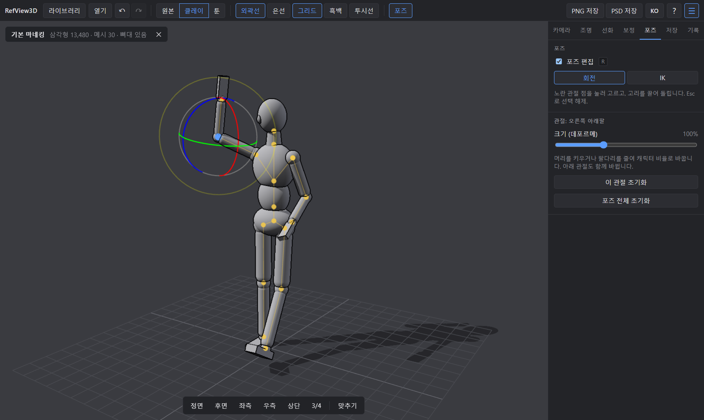

<div align="center">

# RefView3D

**그림 레퍼런스용 경량 3D 뷰어**

블렌더를 열지 않고도 마네킹 포즈·조명·투시를 잡아 클립 스튜디오나 포토샵으로 바로 넘깁니다.

[](LICENSE)
[](https://github.com/Devleu0/refview3d/actions/workflows/ci.yml)
[](https://github.com/Devleu0/refview3d/releases)

[English](README.md) · **한국어**



</div>

## 기능

- **모델 열기** — OBJ, STL, FBX, glTF, GLB. 파일 대화상자 또는 창에 끌어다 놓기.
- **라이브러리** — 폴더를 추가하면 안의 모델을 썸네일로 모아 봅니다. 폴더를 감시해 새로 넣거나 고친 파일이 자동으로 반영됩니다.
- **조명** — 그림자가 지는 주광원, 보조광·환경광, 대표 조명 프리셋 6가지(3/4광, 정면광, 측광, 역광, 탑라이트, 아래에서).
- **음영** — 원본 재질, 회색 클레이, 2~5단계 툰.
- **선화** — 실루엣·겹치는 경계·접힌 모서리 외곽선, 가려진 모서리를 점선으로 보여 주는 은선.
- **명도 확인** — 흑백 보기와 색상·채도·명도·대비 보정.
- **투시 가이드** — 지금 카메라의 소실점 투시선과 눈높이선. 1·2·3점 투시 자동 판정과 1·2·3점 시점 프리셋.
- **포즈** — 기본 목각 마네킹 또는 뼈대가 있는 FBX/glTF. 관절을 직접 돌리거나(FK) 손발을 끌어(IK) 포즈를 잡고, 관절 크기를 바꿔 데포르메.
- **내보내기** — 배경이 투명한 PNG, 또는 음영·그림자·은선·선화와 숨긴 투시선 레이어로 나눈 PSD. 화면의 1·2·4배 크기.
- **모든 작업 실행 취소** — 시점·조명·선화·보정·포즈 변경을 기록하고, 기록 목록에서 원하는 시점으로 돌아갑니다.
- **8개 언어** — English, 한국어, 日本語, 简体中文, 繁體中文, Español, Français, Deutsch. 시스템 언어로 시작하고 툴바에서 바꿀 수 있습니다.

## 다운로드

[Releases](https://github.com/Devleu0/refview3d/releases) 페이지에서 최신 Windows 설치 파일(`RefView3D_x.y.z_x64-setup.exe`)을 받습니다.

> 아직 코드 서명이 되어 있지 않아 Windows SmartScreen 경고가 뜰 수 있습니다. **추가 정보 → 실행**을 누르세요.

Windows 10 / 11 (64비트). WebView2 런타임이 없으면 설치 중에 자동으로 받습니다.

## 빠르게 시작하기

1. 빈 화면의 **기본 마네킹으로 시작**을 누르거나, **Ctrl+O**로 내 모델을 엽니다.
2. **조명** 탭에서 프리셋을 고르고, **S**로 음영을 바꿉니다(원본 → 클레이 → 툰).
3. **R**로 포즈 편집을 켜고 노란 관절을 눌러 고릅니다. 고리를 끌면 회전, **T**로 IK로 바꾸면 화살표를 끌어 팔다리를 굽힙니다.
4. **P**로 투시선을 켜고, **카메라** 탭의 1점·2점·3점 버튼으로 시점을 맞춥니다.
5. **L**로 외곽선을 켠 뒤 **Ctrl+E**(PNG) 또는 **Ctrl+Shift+E**(레이어 PSD)로 저장합니다.

## 단축키

| 동작 | 입력 |
|---|---|
| 회전 / 이동 / 줌 | 왼쪽 드래그 / 오른쪽 드래그 / 휠 |
| 모델 열기 | Ctrl+O, 또는 창에 파일 끌어다 놓기 |
| 라이브러리 열기/닫기 | Ctrl+B |
| 정면·후면·좌측·우측·상단·3/4 시점 | 1 – 6 |
| 화면에 맞추기 | F |
| 음영 전환 (원본 → 클레이 → 툰) | S |
| 외곽선 / 은선 / 그리드 | L / H / G |
| 흑백으로 명도 보기 | B |
| 투시선 | P |
| 포즈 편집 / 회전↔IK / 관절 선택 해제 | R / T / Esc |
| PNG / PSD 저장 | Ctrl+E / Ctrl+Shift+E |
| 실행 취소 / 다시 실행 | Ctrl+Z / Ctrl+Y (Ctrl+Shift+Z) |
| 단축키 보기 | ? |

## 지원 형식

| 형식 | 비고 |
|---|---|
| glTF / GLB | 권장. 재질·텍스처·뼈대·애니메이션 |
| FBX | 재질·텍스처·뼈대 |
| OBJ | 형태만 (MTL 재질은 읽지 않고 중성 회색으로 표시) |
| STL | 형태, 정점 색 |
| SKP | 직접 열 수 없음 — SketchUp에서 glTF 또는 OBJ로 내보내 주세요 |

은선은 뼈대가 있는 스킨드 메시에는 그리지 않습니다(포즈에 따라 모양이 바뀌기 때문).

## 데이터 저장 위치

라이브러리 목록과 썸네일은 `%LOCALAPPDATA%\com.devleu.refview3d`의 `library.db`, `thumbs/`에 저장됩니다. 라이브러리에서 폴더를 빼도 원본 파일은 지우지 않습니다.

## 소스에서 빌드

사전 준비 (Windows): [Node.js](https://nodejs.org/) 20+, [Rust](https://rustup.rs/) stable, Visual Studio Build Tools의 **C++를 사용한 데스크톱 개발** 워크로드.

```bash
npm install
npm run tauri dev     # 데스크톱 앱 실행
npm run dev           # 브라우저에서 UI만 확인 (라이브러리·네이티브 대화상자 제외)
npm run tauri build   # 설치 파일 빌드 → src-tauri/target/release/bundle
```

린트와 타입 검사는 `npm run lint`, `npm run build`.

### 기술 스택

| 영역 | 선택 |
|---|---|
| 데스크톱 셸 | Tauri 2 (Rust, WebView2) |
| UI | React, TypeScript, Zustand |
| 3D | Three.js (WebGL2) |
| 라이브러리 인덱스 | Rust `notify` + SQLite(`rusqlite`), 썸네일은 Three.js 오프스크린 렌더 |
| 내보내기 | 투명 PNG, `ag-psd` 레이어 PSD |

### 폴더 구조

```
src/
  app/       앱 셸, 공용 동작, 단축키
  viewer/    Three.js 씬·카메라·조명·선화·포즈·투시
  loaders/   모델 로더, 기본 마네킹
  library/   라이브러리 API, 썸네일 렌더러
  export/    PNG/PSD 내보내기
  i18n/      번역 (locales/*.ts)
  store/     Zustand 상태, 실행 취소 기록
  ui/        툴바·패널·오버레이
src-tauri/   Rust 백엔드 (파일 접근, 라이브러리 DB, 폴더 감시)
```

### 릴리스

`package.json`, `src-tauri/Cargo.toml`, `src-tauri/tauri.conf.json`의 버전을 올리고 [CHANGELOG.md](CHANGELOG.md)를 고친 뒤 `v0.1.0` 같은 태그를 push합니다. [Release 워크플로](.github/workflows/release.yml)가 Windows 설치 파일을 빌드해 초안 릴리스를 만듭니다.

## 기여

버그 제보와 PR을 환영합니다. PR 전에 `npm run lint`와 `npm run build`를 확인해 주세요.

**번역:** 언어마다 [`src/i18n/locales`](src/i18n/locales)의 파일 하나입니다. `ko.ts`가 기준이고, 다른 파일은 키가 정확히 같아야 합니다(타입 검사가 확인합니다). 새 언어는 `en.ts`를 복사해 번역하고 [`src/i18n/index.ts`](src/i18n/index.ts)에 등록하면 됩니다.

## 라이선스

[MIT](LICENSE) © 2026 Devleu
