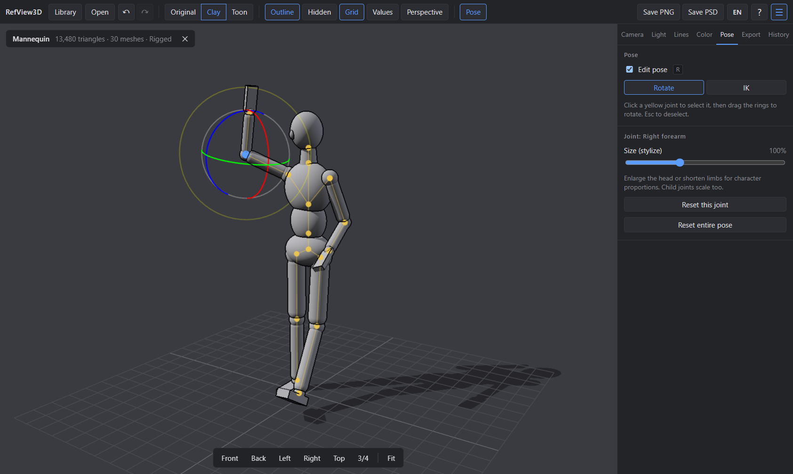

<div align="center">

# RefView3D

**A lightweight 3D reference viewer for illustrators**

Pose a mannequin, set up lighting and perspective, and send clean references to Clip Studio Paint or Photoshop — without opening Blender.

[](LICENSE)
[](https://github.com/Devleu0/refview3d/actions/workflows/ci.yml)
[](https://github.com/Devleu0/refview3d/releases)

**English** · [한국어](README.ko.md)



</div>

## Features

- **Open your models** — OBJ, STL, FBX, glTF and GLB, by file dialog or drag and drop.
- **Library** — add folders and browse every model inside as thumbnails. Folders are watched, so new or changed files show up automatically.
- **Lighting** — key light with shadows, fill and ambient light, six classic presets (3/4, front, side, rim, top, from below).
- **Shading** — original materials, plain clay, or toon shading with 2–5 tones.
- **Line art** — clean outlines (silhouettes, overlaps, creases) and dashed hidden lines.
- **Value check** — grayscale view plus hue, saturation, brightness and contrast.
- **Perspective guides** — vanishing-point lines and eye level for the current camera, with automatic 1/2/3-point detection and one-click 1/2/3-point camera presets.
- **Posing** — a built-in wooden mannequin, or your own rigged FBX/glTF. Rotate joints directly or drag hands and feet with IK. Scale joints for stylized proportions.
- **Export** — transparent PNG, or a layered PSD (shading, shadow, hidden lines, line art, and a hidden perspective layer) at 1×, 2× or 4× screen size.
- **Undo everything** — camera, lighting, lines, color and pose changes, with a clickable history list.
- **8 languages** — English, 한국어, 日本語, 简体中文, 繁體中文, Español, Français, Deutsch.

## Download

Get the latest Windows installer (`RefView3D_x.y.z_x64-setup.exe`) from the [Releases](https://github.com/Devleu0/refview3d/releases) page.

> The installer is not code-signed yet. If Windows SmartScreen warns you, choose **More info → Run anyway**.

Requires Windows 10 or 11 (64-bit). The WebView2 runtime is installed automatically if missing.

## Quick start

1. Click **Start with the mannequin** on the empty screen, or open your own model with **Ctrl+O**.
2. Pick a lighting preset in the **Light** tab and switch shading with **S** (original → clay → toon).
3. Press **R** to edit the pose: click a yellow joint, then drag the rings (rotate) or press **T** and drag the arrows (IK).
4. Press **P** for perspective guides, and use the 1-pt / 2-pt / 3-pt buttons in the **Camera** tab.
5. Turn on outlines with **L**, then save with **Ctrl+E** (PNG) or **Ctrl+Shift+E** (layered PSD).

## Keyboard shortcuts

| Action | Keys |
|---|---|
| Orbit / pan / zoom | Left drag / right drag / wheel |
| Open model | Ctrl+O, or drop a file onto the window |
| Toggle library | Ctrl+B |
| Front · back · left · right · top · 3/4 view | 1 – 6 |
| Fit to screen | F |
| Cycle shading (original → clay → toon) | S |
| Outline / hidden lines / grid | L / H / G |
| Grayscale value check | B |
| Perspective guides | P |
| Pose editing / rotate ↔ IK / deselect joint | R / T / Esc |
| Save PNG / PSD | Ctrl+E / Ctrl+Shift+E |
| Undo / redo | Ctrl+Z / Ctrl+Y (Ctrl+Shift+Z) |
| Show shortcuts | ? |

## Supported formats

| Format | Notes |
|---|---|
| glTF / GLB | Recommended. Materials, textures, skeletons and animations |
| FBX | Materials, textures and skeletons |
| OBJ | Geometry (MTL materials are not read; shown in neutral gray) |
| STL | Geometry, vertex colors |
| SKP | Not supported directly — export to glTF or OBJ from SketchUp |

Hidden lines skip skinned (rigged) meshes, because their shape changes with the pose.

## Where data is stored

The library index and thumbnails live in `%LOCALAPPDATA%\com.devleu.refview3d` (`library.db`, `thumbs/`). Removing a folder from the library never deletes your files.

## Building from source

Prerequisites (Windows): [Node.js](https://nodejs.org/) 20+, [Rust](https://rustup.rs/) stable, and Visual Studio Build Tools with the **Desktop development with C++** workload.

```bash
npm install
npm run tauri dev     # run the desktop app
npm run dev           # UI only, in the browser (no library / native dialogs)
npm run tauri build   # build the installer into src-tauri/target/release/bundle
```

Lint and type-check with `npm run lint` and `npm run build`.

### Tech stack

| Area | Choice |
|---|---|
| Desktop shell | Tauri 2 (Rust, WebView2) |
| UI | React, TypeScript, Zustand |
| 3D | Three.js (WebGL2) |
| Library index | Rust `notify` + SQLite (`rusqlite`); thumbnails rendered off-screen with Three.js |
| Export | Transparent PNG, layered PSD via `ag-psd` |

### Project structure

```
src/
  app/       app shell, shared actions, shortcuts
  viewer/    Three.js scene, camera, lights, line art, posing, perspective
  loaders/   model loaders and the built-in mannequin
  library/   library API and thumbnail renderer
  export/    PNG / PSD export
  i18n/      translations (locales/*.ts)
  store/     Zustand state, undo history
  ui/        toolbar, panels and overlays
src-tauri/   Rust backend (file access, library database, folder watching)
```

### Releasing

Bump the version in `package.json`, `src-tauri/Cargo.toml` and `src-tauri/tauri.conf.json`, update [CHANGELOG.md](CHANGELOG.md), then push a tag such as `v0.1.0`. The [Release workflow](.github/workflows/release.yml) builds the Windows installer and creates a draft release.

## Contributing

Bug reports and pull requests are welcome. Please run `npm run lint` and `npm run build` before opening a PR.

**Translations:** each language is one file in [`src/i18n/locales`](src/i18n/locales). `ko.ts` is the reference — every other file must contain exactly the same keys, which the type checker enforces. To add a language, copy `en.ts`, translate it, and register it in [`src/i18n/index.ts`](src/i18n/index.ts).

## License

[MIT](LICENSE) © 2026 Devleu
